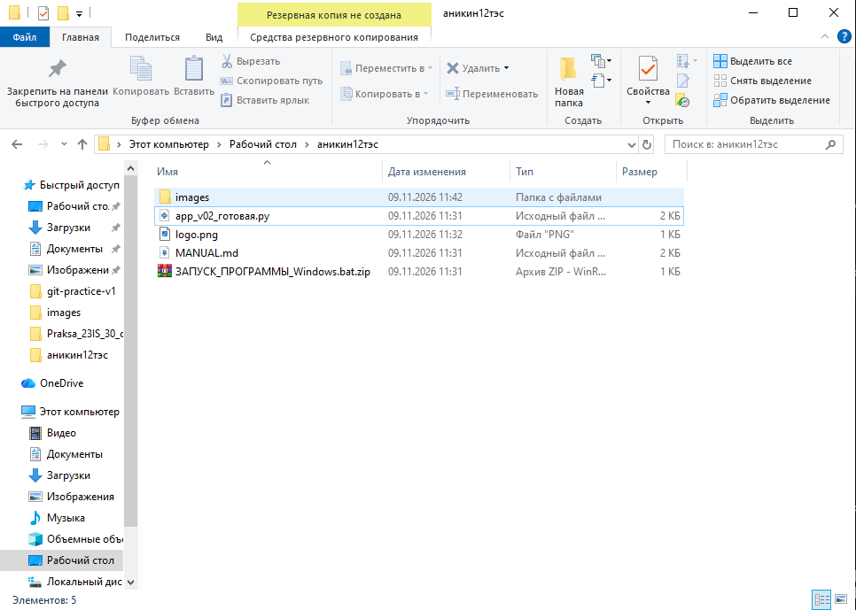
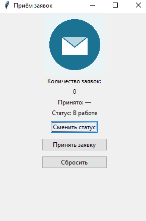

# [Название программы]

Автор:  Аникин 
Группа: Олег   
Версия программы: 0.2.1

## Назначение
Программа предназначена для заказчика. выполняет функции приема, отслеживания и контроля статуса заявок.

## Запуск
два шага: 1 - положить app_v02.py и logo.png в одну папку 
2 -выполнить python app_v02.py. 

## Приём заявки
1. что нажать: кнопки "Сменить статус", "Принять заявку", "Сбросить"
2. что проверить: счётчик растёт, появляется время; при 10 заявках надпись меняется на «Лимит: 10», кнопка блокируется.

## Смена статуса
нажать кнопку "Сменить статус"
результат - статус меняется на "Новая", "В работе", "Готово" по кругу 

## Сброс счётчика
нажать кнопку  "Сброс" 
результат - количество заявок, дата принятия и статус сбрасываются безвозвратно 

## Скриншот

## Результат проверки
Проверяющий:  Аникин Олег 

результат проверки: все функции работают, 

## Доработка
доработка не нужна, так как программа успешно справляется с задачами. она простая и понятная
